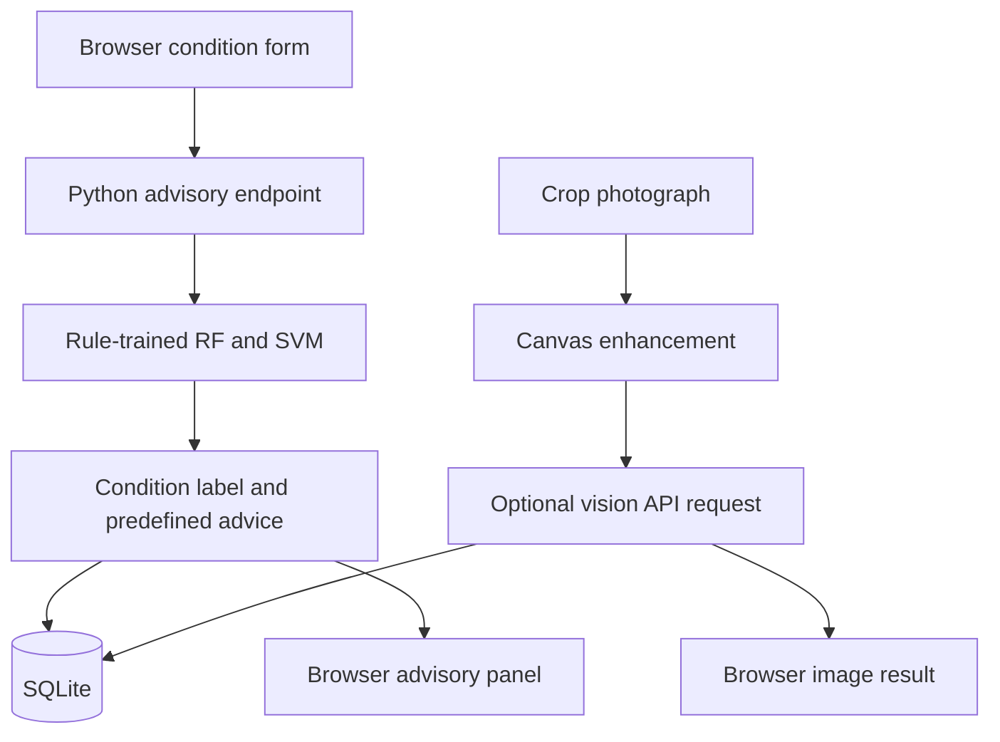

Crop Advisory Recommendation System — CropAdvisor

A browser-based crop-condition advisory and image-enhancement prototype with a Python backend and SQLite storage. The interface supports condition inputs, rule-derived Random Forest/SVM predictions, browser photo enhancement, and optional Gemini or Groq vision analysis.
Important Implementation Distinction

The repository contains two separate machine learning workflows:
Workflow	Inputs	Output	Used by the website?
Runtime crop-condition advisory in backend/app.py	Six categorical field conditions, encoded into 23 values	Condition/risk label and rule-derived readiness	Yes
Offline training in backend/train_numeric_model.py	N, P, K, temperature, humidity, pH, rainfall	Recommended crop class	No — saved artifacts are not loaded by app.py

The recorded 99% accuracy metrics belong to the offline crop recommendation experiment. They do not establish the accuracy of the website's condition advisories or vision analysis.
Preview
Upload preview images into an images directory, then uncomment:

Generated previews are design mockups rather than screenshots of a running application.
Features Implemented in Source
- Six condition selectors: crop, growth stage, soil, moisture, rainfall, and temperature.
- Random Forest and SVM trained at backend startup from generated local-rule examples.
- Configurable ensemble or individual-model selection.
- Rule-derived field-readiness score and predefined advice sections.
- Frontend rule fallback when backend requests fail.
- Crop-image file selection and drag-and-drop.
- Browser canvas brightness, contrast, saturation, and sharpness controls.
- Enhanced PNG download and browser-computed image heuristics.
- Optional image analysis through configured Gemini or Groq APIs.
- SQLite persistence of backend advisory results and image-analysis metadata.
- Static example schedule and explanatory insight sections.
There is no live weather integration, user login, history retrieval API, or implemented local CNN inference. Although CNN-related variables remain in app.py, no CNN is loaded or called, and /api/status returns Random Forest, SVM, and image API status.
Technology
Layer	Technology
Frontend	HTML, CSS, vanilla JavaScript, Canvas API
HTTP server	Python ThreadingHTTPServer and SimpleHTTPRequestHandler
Runtime ML	scikit-learn RandomForestClassifier and SVC
Offline training	pandas, StandardScaler, scikit-learn, joblib
Storage	SQLite through Python sqlite3
Vision requests	Python urllib HTTP requests to Gemini or Groq

The backend uses Python's standard-library HTTP server; it is not a Flask or FastAPI application. No Node build step is required.
Workflow

Condition Inputs
Field	Supported choices
Crop	rice, wheat, maize, cotton, tomato
Stage	vegetative, flowering, fruiting, harvest
Soil	loamy, clay, sandy, black, red
Moisture	low, moderate, high
Rain	none, light, heavy
Temperature	cool, normal, hot

Despite the term “numeric advisory” in the API documentation, the public form accepts categorical descriptions. The backend one-hot encodes these into 23 numeric features.
Runtime Models and Rules
At startup, load_numeric_models() enumerates 2,700 combinations and labels them using rule_label():
- Random Forest: 120 trees, random_state=7.
- SVM: RBF kernel, probability enabled, random_state=7.
- Both fit the complete generated examples, without a held-out evaluation in this workflow.
- Startup does not load backend/models/*.joblib.
- If scikit-learn cannot load/train, the backend can fall back to rules.
- Ensemble mode counts model votes. A two-model tie is resolved by insertion order, favouring the Random Forest vote.
Generated training labels in the reviewed code are dry_stress (1,450), normal (450), and water_risk (800). A crop_damage_risk advice branch exists but is not reached by the supported generated combinations.

The rules' labels/readiness depend on moisture, rainfall, temperature, and growth stage; crop and soil do not change the training label. Models trained on these examples imitate the rule system rather than learn independently validated agronomic relationships.
Field Readiness
Readiness starts at 82, applies fixed adjustments for moisture, heavy rain, heat, growth stage, and rain/moisture combinations, then clips to 35–96. It comes from the rule calculation regardless of the selected classifier.

This score is a heuristic, not model confidence, crop yield, or a validated percentage of field health. For the example Rice / Vegetative / Loamy / Moderate / No rain / Normal input, the rule readiness is 86.
Image Lab
The frontend resizes photos to fit the canvas, applies display adjustments, computes browser pixel/clarity heuristics, and sends the enhanced canvas image as a base64 PNG to /api/image-analysis.

Browser clarity, exposure, vegetation, and dryness indicators are image heuristics, not validated disease measurements. Enhancement changes pixels and may affect external model interpretation.

With a configured provider key, the backend requests JSON containing label, confidence, and advice. The prompt requests broad categories such as normal, dry stress, water risk, pest/disease risk, crop damage risk, or review needed. It does not implement a validated named-disease classifier.

Without a matching key, the fallback only checks decoded image size and returns image_received or image_too_small, confidence 0, and configuration guidance. This is not crop-health analysis. Provider errors return an error response rather than automatically switching to the other provider.

Provider confidence is model-generated and is not calibrated or evaluated by this project. Labels are lowercased but not strictly checked against the requested vocabulary.
Offline Crop Recommendation Experiment
train_numeric_model.py reads the included numierc dataset/Crop_recommendation.csv — preserve that exact folder spelling unless changing the code.
- 2,200 rows and 22 crop classes in the included CSV.
- Inputs: N, P, K, temperature, humidity, ph, rainfall.
- Target: label.
- Missing rows are dropped for required fields.
- Stratified 80/20 split, seed 42: 1,760 training and 440 test rows.
- Random Forest: 250 trees, seed 42.
- SVM: StandardScaler plus RBF SVC, C=10, probability enabled, seed 42.
Model	Accuracy recorded in supplied JSON
Random Forest	99.55%
SVM	98.86%

These are supplied results, not independently reproduced metrics. Their dataset and test counts match the included CSV's row count, but saved-model prediction agreement was not tested. Do not report these as web advisory or image disease-detection accuracy.

Artifacts are crop_random_forest.joblib, crop_svm.joblib, and their metrics JSON files. joblib files should only be loaded from trusted sources. This review did not deserialize them.
Repository Structure
Run commands from the inner crop/ directory in the uploaded crop_project/ folder.
crop/
├── README.md
├── run_project.bat
├── Untitled-1.ipynb
├── frontend/
│   ├── index.html
│   ├── styles.css
│   ├── script.js
│   └── README.md
├── backend/
│   ├── app.py
│   ├── database.py
│   ├── train_numeric_model.py
│   ├── requirements.txt
│   ├── README.md
│   └── models/
├── database/
│   ├── schema.sql
│   ├── README.md
│   └── crop_advisor.sqlite3
└── numierc dataset/
    └── Crop_recommendation.csv
The upload includes a real .env and an existing SQLite file. Keep credentials and saved user records out of a public repository. The supplied ZIP does not include .env.example, despite the older README referring to it; create a placeholder example if needed.
Setup and Run
Requirements
- Python 3.10+ as specified by the original project documentation.
- pip and a fresh virtual environment.
- Internet/provider key only for optional external vision requests.
The dependency file contains:
scikit-learn>=1.4
numpy>=1.26
pandas>=2.2
joblib>=1.4
Versions are not pinned; record a tested environment for reproducible results.
Windows PowerShell
From the project root:
cd backend
python -m venv .venv
.\.venv\Scripts\python.exe -m pip install -r requirements.txt
.\.venv\Scripts\python.exe app.py
macOS / Linux
cd backend
python3 -m venv .venv
source .venv/bin/activate
python -m pip install -r requirements.txt
python app.py
Open http://localhost:3000. Startup may take time because the runtime models are trained on every launch.

The backend serves frontend/ and the API from the same host. Opening the HTML directly invokes the JavaScript fallback API URL http://localhost:3000, but the backend must still run for API operations and database writes.

run_project.bat is an alternative launcher using its configured Python invocation; the explicit environment command above avoids ambiguity about which interpreter runs the app.
Environment Configuration
Create backend/.env manually if absent. The custom loader uses existing process environment values before local file values.
PORT=3000
HOST=localhost
NUMERIC_MODEL=ensemble
IMAGE_API_PROVIDER=gemini
GEMINI_API_KEY=
GROQ_API_KEY=
NUMERIC_MODEL: ensemble, random_forest, or svm. Unsupported values yield rule-only predictions rather than a configuration validation error.

For external vision, add the matching API key and optionally set GEMINI_MODEL or GROQ_MODEL. The source defaults are gemini-3.5-flash and meta-llama/llama-4-scout-17b-16e-instruct. These are code defaults, not a verification of provider availability or request compatibility. Test the chosen model and provider response format before claiming working vision integration.

The Gemini code posts to an Interactions endpoint but reads output_text or candidates response fields. That integration requires live compatibility verification. This review made no provider calls.

Restart the backend after changing environment settings. Never place keys in frontend JavaScript.
API
GET /api/status
Returns status.random_forest, status.svm, status.image_api, and numericModel. “Ready” image API status reflects key presence; it does not test connectivity or model availability.
POST /api/advisory
{
  "crop": "rice",
  "stage": "vegetative",
  "soil": "loamy",
  "moisture": "moderate",
  "rain": "none",
  "temperature": "normal"
}
Returns an advisory object with title, readiness, prediction, modelVotes, and predefined recommendations, then records it in SQLite.
POST /api/image-analysis
{"image": "data:image/png;base64,..."}
Replace the placeholder with real base64 data. Returns an image object with label, confidence, model, and advice; successful results including no-key fallback metadata are stored.

No API to list saved history is implemented. Request exceptions return HTTP 500 with the exception message, including malformed-input errors.
SQLite Database
The backend creates database/crop_advisor.sqlite3 from database/schema.sql on startup.
Table	Stored data
advisories	Six condition inputs, prediction, readiness, JSON model votes, timestamp
image_analyses	Label, confidence, model name, advice, timestamp

Raw uploaded image bytes are not saved to SQLite by save_image_analysis(). Browser-only fallback advice is not persisted when the backend is unreachable.
Optional Offline Training
From backend/:
python train_numeric_model.py --algorithm both
You may select random_forest or svm, or supply --dataset with another compatible CSV. This replaces the corresponding saved artifacts and metrics. It does not connect them to the website; a separate form, endpoint, and inference integration would be needed for the seven-feature crop recommendation task.
Review and Testing Status
- All three Python source files passed syntax parsing.
- The generated rule dataset was checked: 2,700 rows, 23 encoded features, and three reachable labels.
- The no-model rule fallback was checked for the documented sample: normal, readiness 86.
- CSV row/class counts and supplied metric metadata were inspected.
- The full HTTP application, startup-trained models, external vision calls, browser UI, and database persistence were not exercised.
- No automated test suite is included in the supplied package.
Useful next checks include startup status, a valid advisory plus database insert, missing-key image fallback, invalid JSON, malformed/oversized image input, and an explicit live provider smoke test using a non-sensitive image.
Limitations and Next Improvements
- Runtime training uses synthetic rule labels without independent field validation.
- No evaluated CNN or named crop-disease detector is implemented.
- Frontend fallback and backend rule advice use separate logic and may differ.
- Direct API callers can send unsupported category strings; strict schema validation is absent.
- No explicit request-body/image-size limit, authentication, or rate limit is implemented.
- CORS allows all origins; narrow it before shared deployment.
- Provider responses and image data need stronger validation; errors should be mapped to suitable HTTP statuses.
- The example seven-day schedule is static, not a generated or scheduled task system.
- Use a deployment-ready server and reviewed agronomic guidance before offering this beyond a demonstration.
License and Attribution
No project-level license was found among the uploaded files. Add verified contributor names and confirm code/dataset reuse permissions before publication. Crop recommendations and vision output require local expert review before field decisions.
